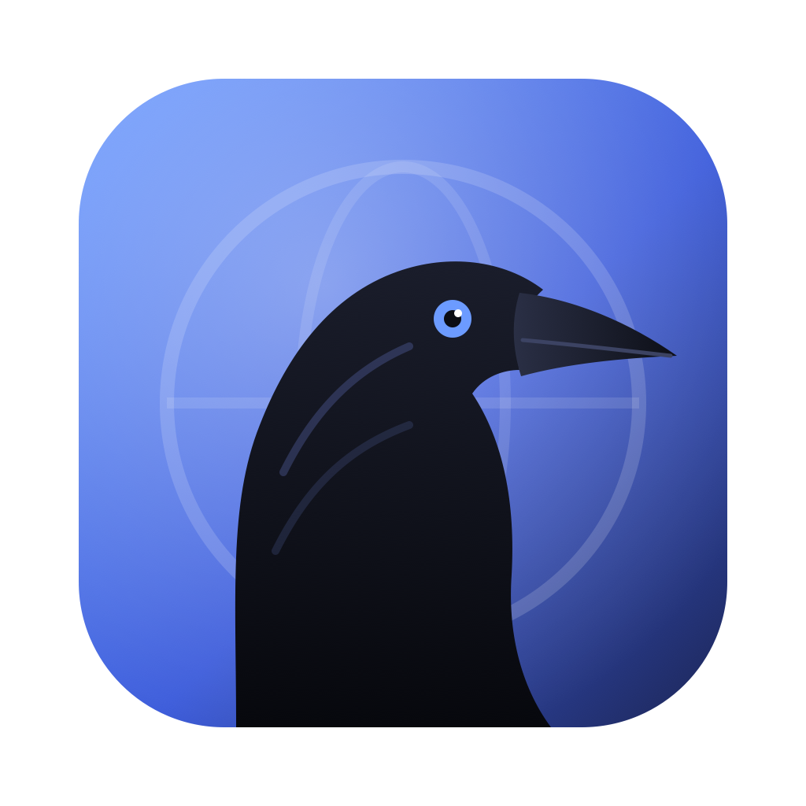

<p align="center">
  
</p>

<h1 align="center">Crow</h1>

<p align="center">
  Ľahký, súkromný a šifrovaný webový prehliadač pre macOS a Linux, napísaný v Ruste.<br>
  Postavený na systémovom WebKite (na Linuxe WebKitGTK), žiadny Chromium ani Electron.
</p>

---

## Prečo Crow

- **Ľahký**: hlavný proces zaberá okolo 35 MB RAM a spustiteľný súbor má 1,8 MB. Neaktívne karty sa automaticky uspávajú.
- **Šifrovaný**: história, obľúbené, cookies, prihlásenia, karty aj nastavenia sú na disku zašifrované heslom (Argon2id + XChaCha20-Poly1305). Bez hesla ich nikto neprečíta.
- **Bez reklám**: reklamy a sledovače sa blokujú priamo v sieťovej vrstve WebKitu, ešte pred pripojením.
- **Kompatibilný**: používa WebKit z macOS, rovnaký engine ako Safari, takže moderné weby fungujú.
- **Natívny**: priehľadná lišta okna, tmavý a svetlý motív, klávesové skratky ako v Safari či Chrome.

Cieľový hardvér: MacBook Air 2015 (Intel Core i5 Broadwell, 4 GB RAM), macOS 12 Monterey a novší. Linux: Arch, Debian/Ubuntu, Fedora s WebKitGTK 4.1, Wayland aj X11.

## Inštalácia

1. Otvor `dist/Crow-<verzia>.dmg`.
2. Presuň ikonu **Crow** do priečinka **Aplikácie**.
3. Pri prvom spustení si nastav heslo trezora (aspoň 8 znakov).

> Ak si DMG stiahol z internetu, macOS môže zobraziť „nedá sa overiť vývojár“. Klikni na aplikáciu pravým tlačidlom a zvoľ **Otvoriť**.

## Vývoj

```sh
cargo run                       # debug spustenie
cargo build --release           # optimalizovaný build
./scripts/bundle.sh             # target/Crow.app s ikonou
./scripts/make_dmg.sh           # dist/Crow-<verzia>.dmg (inštalátor)
./scripts/make_dmg.sh --skip-build   # len znova zabalí existujúcu .app
```

Požiadavky: Rust (stable, edícia 2024), Xcode Command Line Tools.

Linux: `./scripts/install_linux.sh` (balíky a podrobnosti v [docs/BUILD.md](docs/BUILD.md#linux-webkitgtk)).

## Dokumentácia

| Dokument | Obsah |
|---|---|
| [docs/FUNKCIE.md](docs/FUNKCIE.md) | Všetky funkcie, tlačidlá a nastavenia |
| [docs/SKRATKY.md](docs/SKRATKY.md) | Klávesové skratky |
| [docs/BEZPECNOST.md](docs/BEZPECNOST.md) | Šifrovanie, trezor, čo je a čo nie je chránené |
| [docs/ARCHITEKTURA.md](docs/ARCHITEKTURA.md) | Štruktúra kódu, moduly, tok dát |
| [docs/BUILD.md](docs/BUILD.md) | Build, balenie do .app a .dmg, assety |
| [docs/OBMEDZENIA.md](docs/OBMEDZENIA.md) | Známe obmedzenia a plány |
